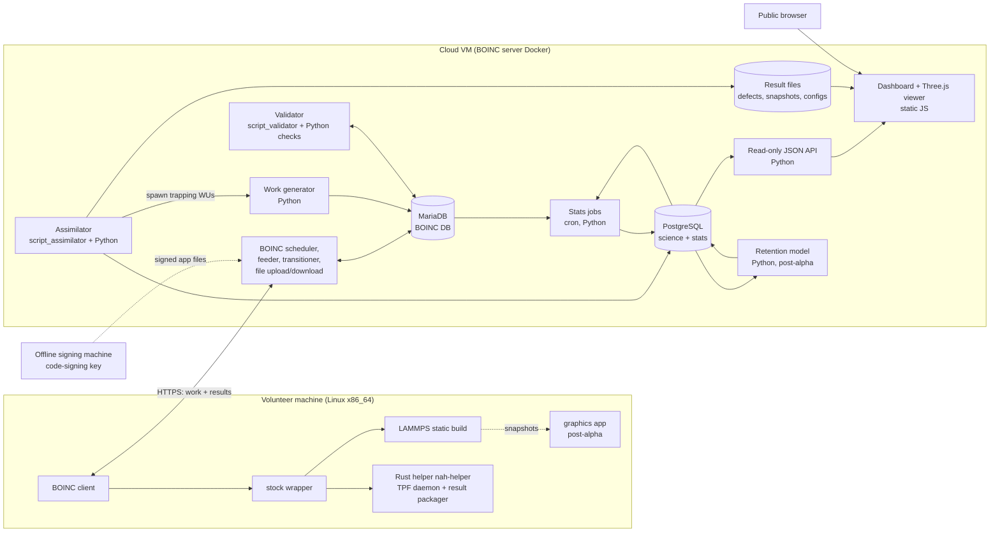

# Nuclear@Home — architecture (Phase 1)

Status: DRAFT — awaiting human review. Design only; no implementation yet.

## 0. Constraints this design follows

Decided by the human in Phase 1:

| Topic | Decision |
|---|---|
| Server | BOINC server on one cheap cloud VM (official BOINC server Docker image) |
| Clients | Linux x86_64 only for the alpha |
| Wrapper | BOINC's stock `wrapper` (job.xml); a small Rust helper does the project-specific client work. No custom C++ wrapper. |
| Audience | Open to the public (so privacy policy, GDPR consent, code signing, and server hardening are launch blockers) |
| Test machines | No dedicated test fleet. Testing uses mock volunteers, the developer's own machine as a BOINC client, then the public alpha. |
| Developer hardware | 8-core Intel i7, ~32 GB RAM, NVIDIA GPU. Used as the reference machine for credit calibration and for local benchmark runs. |
| Recoil spectrum | Not available yet. The alpha uses a fixed grid of PKA energies. |

Assumed, not yet confirmed (see decision D1): the alpha ships **cascade work units only**.
Trapping work units and the retention model are designed here, but built after the alpha.

Principle: use stock BOINC and LAMMPS features first, and write project code only where they stop.

| Need | Stock feature used | Project code |
|---|---|---|
| Run LAMMPS, suspend/resume, checkpoint signal, progress | `wrapper` + job.xml (`<checkpoint_filename>`, `<fraction_done_filename>`, `<daemon/>` tasks) | none |
| Checkpoint/restart | LAMMPS `write_restart` / `read_restart` | input template logic |
| Wigner–Seitz defect analysis | LAMMPS `compute voronoi/atom` with `occupation` | none on the client |
| Validation framework, quorum, adaptive replication, quotas | BOINC `script_validator`, `target_nresults`, host `consecutive_valid`, daily quotas | Python checks V1–V10 |
| Credit | Validator flag `--credit_from_wu`, so credit = server-set points in the WU | points formula (`stats/ppd.py`) |
| Daily XML stats export, teams, user accounts | BOINC `db_dump`, BOINC web code | none |
| Assimilation hook | BOINC `script_assimilator` | Python ingest into PostgreSQL |

## 1. Components

| Component | Runs on | What it does | Built in |
|---|---|---|---|
| BOINC server (scheduler, feeder, transitioner, upload/download, web) | server | Stock BOINC: hands out work, takes back results, user/team accounts, forums | Phase 9 deploy |
| MariaDB | server | Stock BOINC database: hosts, users, WUs, results, credit | stock |
| Work generator | server | Picks parameters (fixed energy grid for now, later the recoil spectrum), favoring under-sampled bins. Sets base points from `stats/ppd.py`, then calls `create_work`. Also creates canaries and, post-alpha, trapping WUs. | 3 |
| Client app | volunteer | Stock `wrapper` runs LAMMPS with a Nuclear@Home input template, then the Rust helper. Ships as one signed app version per Linux x86_64 build. | 3–4 |
| LAMMPS static build | volunteer | Minimal package set (MANYBODY, EXTRA-FIX for electronic stopping and the two-temperature model, VORONOI for Wigner–Seitz occupation, plus whatever the chosen potentials need, TODO-DECIDE) linked statically, so it runs on any recent Linux. GPL-2: we publish its source and build recipe. | 4 |
| Rust helper `nah-helper` | volunteer | Two modes. `monitor` is a wrapper `<daemon/>`: it measures TPF from the progress file and skips suspended time. `package` runs after LAMMPS: it clusters the Wigner–Seitz defects, assembles `result.json` per `result_schema.json`, computes sha256 checksums, and compresses outputs. | 4 |
| Graphics app | volunteer | Renders the volunteer's own run from periodic snapshot files. Post-alpha (decision D5). | post-alpha |
| Validator | server | BOINC `script_validator` calls Python checks V1–V10 (pure functions). Replicas are compared by population statistics, not to each other. Canary comparison, outlier hold, trust handling. | 5 |
| Assimilator | server | Takes each canonical valid result: moves files to science storage, inserts rows into PostgreSQL, queues trapping WUs (post-alpha). | 7 |
| PostgreSQL | server | Science tables and extended stats per `stats_spec.md`, including the server-only `canaries` table | 7 |
| Result file storage | server | Defect files, snapshots, final configs on the VM disk, with nightly off-site backup (decision D6) | 7 |
| Stats jobs | server | Cron jobs: hourly estimated PPD from TPF samples; daily host/user/team tables, ranks, badges, science aggregates with error bars. BOINC `db_dump` does the XML export. | 6–7 |
| API | server | Read-only, versioned JSON (`/api/v1/...`). Never exposes IPs, emails, or canary status. | 7 |
| Dashboard + web viewer | browser | Static JavaScript pages: dashboard charts, plus a Three.js viewer for finished cascades from snapshot files | 7–8 |
| Retention model | server | Rate theory or kinetic Monte Carlo per `retention_chain.md`, versioned runs, uncertainty band | post-alpha |
| Offline signing machine | developer, offline | Holds the BOINC code-signing private key. App files are signed there, and only the signatures are uploaded. | 9 |

## 2. Data flow

`[V]` = volunteer machine, `[S]` = server.

### 2a. One cascade work unit, creation to science database

1. `[S]` The work generator picks (material, potential, temperature, PKA energy, direction, seed, size tier).
   - Alpha: energies come from a fixed grid.
   - Later: energies come from the recoil spectrum, recorded as `sampled_from_spectrum_id`.
   - Bin choice favors bins with the fewest validated results, weighted by campaign priority.
2. `[S]` Base points = `ref_points × n_atoms × md_steps × cost_factor / ref_work` (`stats/ppd.py`). They go into the WU's `points` field and the BOINC credit field.
3. `[S]` `create_work` registers the WU with its input files:
   - the WU JSON (validated against `workunit_schema.json`)
   - the LAMMPS input template
   - the potential file
   - job.xml

   The canary flag never goes into these files. It is written only to the server-side `canaries` table.
4. `[S]` The scheduler sends the WU. New hosts always get a replica (quorum 2). Trusted hosts are spot-checked.
5. `[V]` The wrapper starts LAMMPS:
   - Equilibrate, apply the PKA, then run the cascade with adaptive timestep, edge thermostat, and electronic stopping.
   - Every N steps: write the progress fraction (read by the wrapper), the energy log, the defect count (from `compute voronoi/atom` occupation), and sparse snapshots.
   - Write a restart file every checkpoint interval; the wrapper's checkpoint signal points at it.
   - Stop when the Frenkel-pair count is stable, or at the hard time limit. All of these settings come from `physics_settings.md`.
6. `[V]` Meanwhile, `nah-helper monitor` records TPF samples.
7. `[V]` On suspend, the wrapper pauses LAMMPS. On restart, the template detects the restart file and resumes.
8. `[V]` `nah-helper package` writes `result.json`, plus `defects`, `final_config`, and `snapshots` (compressed), and sha256 checksums for each. Target total < 5 MB compressed.
9. `[V]` The BOINC client uploads the outputs.
10. `[S]` The validator runs V1–V8. Then, depending on the WU:
    - replica: population test across the 2 results
    - canary: comparison against the reference run
    - outlier: held, then re-issued to 2 trusted hosts
    - pass: BOINC grants credit from the WU (`--credit_from_wu`)
    - fail: no credit, and the host's trust resets
11. `[S]` The assimilator copies files to science storage and inserts `wu_results`, `cascade_stats`, and `tpf_samples` rows. A held outlier enters only after confirmation.
12. `[S]` Stats jobs update aggregates, and the API and dashboard serve them.

### 2b. Spawning trapping work units (post-alpha)

1. `[S]` The assimilator queues the validated cascade (not a canary, not a held outlier) for trapping, if the campaign asks for it.
2. `[S]` The work generator creates trapping WUs from the parent's `final_config_file`: one per (species, wall temperature, insertion method, concentration) chosen by the sampler.
   - The parent config ships as an input file.
   - Size concern: see risk R6 and decision D9.
3. `[V]` LAMMPS inserts H or T (tritium mass for dynamics), anneals for the configured time, then classifies atoms as trapped, free, or desorbed.
4. `[V]` LAMMPS relaxes every trapped site to get binding energies. A configured subset of sites also gets an NEB calculation.
5. `[V]` `nah-helper package` builds the trapping result.
6. `[S]` The validator runs V1–V2, V4, V8–V10, plus replication rules. The assimilator inserts `trapping_stats` and `trap_sites` rows.

### 2c. Trapping results to the retention estimate (post-alpha, server only)

1. `[S]` Defect production statistics: surviving defects and cluster sizes per (material, energy bin, temperature bin) with mean, standard error, bootstrap 95% interval, and n.
2. `[S]` These are folded with the recoil spectrum into defects per unit damage dose. Assumptions A1 and A2 apply.
3. `[S]` The trap parameter table: trap concentration per dose (from step 2) and the binding-energy distribution per trap type (from trapping results). Assumption A3 applies.
4. `[S]` The rate-theory or kinetic Monte Carlo model runs with:
   - wall temperature profile and surface tritium flux (A4)
   - diffusivity and transport parameters (A5)
   - isotope effects (A6)
   - surface recombination (A7)

   It gives tritium retained per m² against operating time.
5. `[S]` Uncertainty is reported as 3 separate bands: statistical, model (spread across potentials), and chain (varying A1–A7). The result is always shown with its assumption list and a plain-language caveat, and compared against published deuterium retention in damaged tungsten (TODO-LIT).

What volunteers compute: only MD cascades and trapping runs (steps 2a.5–8, 2b.3–5).
Everything statistical and every model beyond MD timescales runs on the server.

## 3. Risks

| # | Risk | Why it matters | Mitigation |
|---|---|---|---|
| R1 | The chosen W potential behaves badly at short range (the ZBL blend, or ML extrapolation) | Wrong defect counts across the whole database | Reproduce published benchmarks first. Check threshold displacement energies. Keep 2 potentials so model spread is visible. Record `potential_id` on every row. physics-reviewer signs off before freeze. |
| R2 | Benchmarks cannot be reproduced at laptop scale or with enough statistics | The semester goal fails | Pick benchmark cases in the Small tier (≤ 10 keV). Run replicas on the local GPU (KOKKOS/GPU package). Measure time per run before committing to a replica count (TODO-CALIBRATE). |
| R3 | Electronic stopping / electron–phonon settings dominate the result | Comparisons with literature mismatch for reasons that are not bugs | Treat them as an explicit WU parameter. Match the benchmark paper's treatment exactly. Report results per setting. |
| R4 | Cheating in a chaotic system: a forged result inside the plausible range | Corrupts the science quietly | Replicate every result from new hosts. Hidden canaries with reference runs. Population tests. Outlier hold. Signed app. Only validated results reach PostgreSQL. A failed canary resets trust. |
| R5 | `plausible_ranges.csv` stays empty | V7 fails every result, so the alpha stalls | Fill it from verified literature or the developer's own reference runs (marked by run ID). The table stays empty until then; no invented values. |
| R6 | Stage A→B config files are too large for a cheap VM's disk and bandwidth | Storage cost, slow downloads | Measure real file sizes in Phase 4. Options: crop a region around the cascade, store only configs queued for trapping, delete after trapping completes (decision D9). |
| R7 | The retention extrapolation (nanoseconds of MD to years of reactor operation) is weak science | Misleading public number | Post-alpha only. Always show 3 uncertainty bands and the assumption list. Label it "model estimate". Get advisor review before any public claim. |
| R8 | The public server gets compromised | Malware served to volunteers; data leak | Offline code signing. HTTPS only. Firewall: only 80/443 open, SSH by key. BOINC upload size limits. Read-only API. Nightly off-site backups. security-reviewer on every server/web change. Invite-only beta before open signup (D4). |
| R9 | One developer at 10 h/week, no advisor | Schedule slip; physics mistakes go unnoticed | Cascade-only alpha. Stock BOINC parts wherever possible. Small task cards for subagents. physics-reviewer as a stand-in, but find a faculty advisor before publishing any data. |
| R10 | Checkpoint/restart or suspend breaks results | Bad energy logs, stuck progress, lost volunteer work | Restart-aware LAMMPS template. Energy log continues across restarts (V4 handles segments). An integration test kills and restarts the client mid-run. Rust helper TPF test for suspend gaps. |

Also tracked (not top 10):
- LAMMPS GPL-2 compliance: publish the source plus the build recipe.
- Rust learning curve: the helper stays small, and its interface is frozen first.
- Privacy and GDPR: BOINC's built-in consent tools plus a written privacy policy.

## 4. Decisions for the human

| # | Decision | Recommendation | Trade-off |
|---|---|---|---|
| D1 | Alpha scope | Cascade WUs only. Trapping and retention are designed now and built after the alpha. | Fits 10 h/week and the benchmark goal. Trapping science starts a semester later. |
| D2 | Quick-return bonus in the alpha | Not in the alpha. BOINC credit = server base points (`--credit_from_wu`). | Stock validator, no custom credit code. Volunteers get no speed reward yet. The math stays in `stats/ppd.py` for later. |
| D3 | Host trust | BOINC's built-in adaptive replication (`consecutive_valid`), plus a canary-failure reset done by our validator | Almost no code. Less tunable than a custom score. `validator_spec.md` would be rewritten to match in Phase 2. |
| D4 | Launch | Invite-only beta (a few dozen volunteers) first, then open signup | Finds bugs before strangers do. Delays "public" by a few weeks. |
| D5 | Screensaver graphics app | Post-alpha. The web viewer covers visualization first. | Saves a whole native component. Volunteers see no live 3D in the BOINC Manager at launch. |
| D6 | Science file storage | VM disk plus nightly off-site backup | Cheapest and simplest. Object storage scales better; move there when the disk fills. |
| D7 | PKA energies without a spectrum | Fixed grid matching the benchmark energies (values TODO-LIT, from the benchmark papers) | Benchmarks work at once. Production statistics wait for the spectrum file. |
| D8 | First potential | One EAM-type W potential from the verified literature list. ML potentials come after the alpha. The ZBL join (range and function) is part of the choice, recorded with the potential. | Fast and well studied. Model spread is unknown until a second potential runs. The UNVERIFIED lit notes (`docs/literature/w_potentials.md`) report that the EAM files carry no ZBL join of their own, and that threshold displacement energy depends strongly on the join. So the join is a physics decision, not a default. ML potentials with a built-in join avoid this, at higher cost per step. |
| D9 | Stage B input size | Decide after measuring Phase 4 output sizes. Cropping around the cascade is the likely choice. | Cropping saves bandwidth but changes the boundary conditions for trapping, so it needs physics review. |
| D10 | GPU | No GPU app version in the alpha. Use your NVIDIA GPU for local reference and benchmark runs. | Simpler client release. GPU volunteers are idle until a later app version. |
| D11 | TPF under the stock wrapper | Rust `monitor` daemon. A gap between polls longer than 3× the poll interval counts as suspended time and is excluded (the factor needs your approval). | Works without the BOINC API. It is a heuristic. The alternative is no live TPF. |
| D13 | Energy check (V4) for trapping runs | Apply V4 only to the anneal MD segment, normalized per inserted atom or per atom (TODO-DECIDE). Specify the anneal thermostat in `physics_settings.md`. | Without this, a fail-closed V4 rejects every trapping result. Post-alpha, but it shapes the result schema. |
| D12 | Faculty advisor | Find one before the public alpha announces any science results | None, except time spent looking |

## 5. Open scientific questions

- Which W potential(s) reproduce threshold displacement energies and published cascade statistics best at ≤ 10 keV (the lit-researcher list is under review)?
- Is electronic stopping alone enough for the benchmark cases, or does the source paper use a two-temperature model?
- Which stop-condition window gives a stable Frenkel-pair count without wasting volunteer time? Settled by convergence tests in Phase 9.
- Is a cropped cascade region valid input for trapping (D9)?
- Can trap binding energies from relaxation feed rate theory directly (A3)?
- What does "desorbed" mean in a periodic box with no free surface? This must be defined before V9 and the retention chain use `n_desorbed`.

## 6. Phase 2 carry-overs from the Phase 1 physics review

These go into T-003 (result schema) and T-005 (validator spec) before freezing.

- **V1:** `result.wu_id` and `result.wu_type` must equal the WU's. The validator chooses which checks to run from the WU, never from the result.
- **V2:** every file the result references (`defect_file`, `final_config_file`, `snapshot_files`, `trap_file`) must appear in `output_sha256`.
- **V4:** the first energy sample must be step 0.
- **V5:** fewer than N history points means FAIL.
- **Number parsing:** reject NaN and Infinity when parsing results (for example `parse_constant` that raises), and check every number with `isfinite`.
- **V9:** `sum(trap_sites[].n_occupants) == n_trapped_end`. `cluster_size` is required for cluster site types.
- **V10:** the count of non-null binding energies must match `min(max_sites, len(trap_sites))`, and every non-null value must be finite and within range.
- **V8:** require `box.n_atoms_expected`, or define how it is computed. For trapping, define the expected count as the parent's atoms plus the inserted atoms.
- **V3:** add `run.stop_reason` (stabilized / hard_limit), or define V3 from V5 plus `simulated_time_ps`.
- **Canaries (security review, needs your approval):** canaries must look like normal work in every field a client or the website shows: WU name from the normal sequence, normal `campaign_id`, the same replication, deadline and fpops as the tier, normal credit and counting in public tables, and identical per-WU API behavior. Seeds come from a reference-run pool large enough that no host or user gets the same canary seed twice; this replaces "fixed seed". Canaries are excluded only from science aggregates, server-side. Accepted risk: a host returned to full replication after failing a canary can guess that a recent WU was one.
- **Credit:** one award entry point that computes `trusted` in one place, from the trust threshold.
- **Credit job:** handle server clock skew (`elapsed_s <= 0` raises) without crashing.
